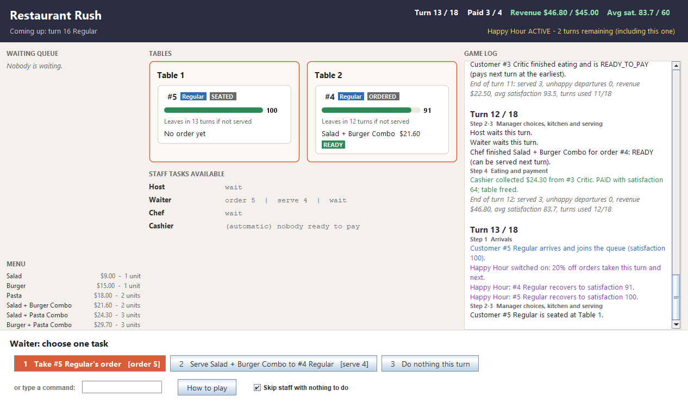

# Restaurant Rush (SC2002 group assignment)

Turn-based restaurant management game for the command line, written in Java 17 (no external libraries, works offline).

* Repository: https://github.com/pyizaw/NTU_SCE1_SC2002
* Lab group: [LAB GROUP]   Members: [Member name 1], [Member name 2], [Member name 3], [Member name 4], [Member name 5]

**Final version: Stage 3**: basic operation, then VIP and Critic customers, then the Host, ComboMeal and Happy Hour. An optional window version sits on top of it in tag `gui-extra`.

## Contents

1. [Build and run](#build-and-run)
2. [Stages and tags](#stages-and-tags)
3. [How to play](#how-to-play)
4. [Documented rules](#documented-rules)
5. [Object-oriented design](#object-oriented-design)
6. [Diagrams](#diagrams)
7. [Change evidence between stages](#change-evidence-between-stages)
8. [Window version (optional extra)](#window-version-optional-extra-tag-gui-extra)
9. [AI history](#ai-history)
10. [Video](#video)
11. [Report](#report)

## Build and run

IntelliJ IDEA: *File > Open* this folder, set the Project SDK to any JDK 17+ if asked, then run **Play (terminal)**, **Play (window)** or one of the **Replay_stageN_...** configurations.

Command line (from this folder):

```bash
javac --release 17 -d out $(find src -name "*.java")
```

```bash
java -cp out restaurantrush.Main
```

Windows PowerShell compile: `javac --release 17 -d out (Get-ChildItem -Recurse src -Filter *.java).FullName`

Optional window version (same game and rules):

```bash
java -cp out restaurantrush.Main --gui
```

Replay a recorded run. Commands are read from the file and echoed, and lines starting with `#` are comments that explain each decision:

```bash
java -cp out restaurantrush.Main runs/stage3-victory.txt
```

## Stages and tags

Each stage is one commit with a tag, so any stage can be checked out and run on its own:

```bash
git checkout stage-2
```

| Tag | Commit | What it adds | Replay scripts (only valid at their own tag) | Result |
|---|---|---|---|---|
| `stage-1` | f461480 | Basic operation: Regular customers, Waiter, Chef, automatic Cashier, 2 tables, 3 dishes, 18 turns | `runs/stage1-victory.txt` / `runs/stage1-defeat.txt` | VICTORY 5 paid, $66.00, avg 79.2 / DEFEAT 3 paid, $42.00, avg 38.7 |
| `stage-2` | 9ce66f8 | VIP (turn 4) and Critic (turn 7) customers | `runs/stage2-victory.txt` / `runs/stage2-defeat.txt` | VICTORY 5 paid, $64.50, avg 78.0 / DEFEAT 3 paid, $31.50, avg 86.0 |
| `stage-3` | 87683ee | Host role, ComboMeal menu items, Happy Hour | `runs/stage3-victory.txt` / `runs/stage3-defeat.txt` | VICTORY 5 paid, $87.84, avg 86.6 / DEFEAT 3 paid, $41.40, avg 85.0 |
| `gui-extra` | d9672e8 | Optional Swing window on top of Stage 3 (no rule changes) | same as `stage-3` | same as `stage-3` |

A later stage's script does not run on an earlier tag because later stages add prompts (Host, Happy Hour). Victory needs at least 4 paid customers, $45.00 revenue and an average paid satisfaction of 60 after turn 18.

## How to play

Each turn runs the five steps from the brief, and the terminal prints a heading for each one:

* **Step 1, Arrivals**: the scheduled customer joins the waiting queue. The board of tables, queue, patience and staff tasks is printed next.
* **Steps 2-3, Manager choices, kitchen and serving**: you give each staff member one task (Host, then Waiter, then Chef).
* **Step 4, Eating and payment**: customers served on an earlier turn finish eating, and the Cashier charges one customer.
* **Step 5, Waiting and abandonment**: unserved customers lose satisfaction, and anyone at 0 walks out without paying.

Each staff member's possible tasks are listed as numbered options. Type the **option number** or the **command**:

| Staff   | Commands                                       |
|---------|------------------------------------------------|
| Happy Hour | `y` / `n` (Enter = no) at the start of each turn until it has been used (Stage 3) |
| Host    | `seat n`, `wait`; acts before the Waiter (Stage 3) |
| Waiter  | `seat n`, `order n`, `serve n`, `wait`         |
| Chef    | `cook n`, `wait`                               |
| Cashier | automatic (one payment per turn, oldest first) |

`n` is the customer number (an order has the same number as its customer). Short forms: `s`, `o`, `v`, `c`, `w`. Press Enter when `wait` is the only option. Type `help` at any prompt. A rejected command explains why and does **not** use up that staff member's task, so you can choose again.

## Documented rules

* **Food choice:** customer number *n* orders the menu item at position *(n - 1) mod menu size*.
* **Arrivals:** Regular on turns 1, 10, 13, 16; from Stage 2, turn 4 is a **VIP** and turn 7 is a **Critic**.
* **Timing:** a dish READY on turn *t* can be served from turn *t + 1*; a customer served on turn *t* finishes eating at step 4 of turn *t + 1* and pays on turn *t + 2* at the earliest.

| Customer | Loss per unserved turn | Bill | Special behaviour |
|---|---|---|---|
| Regular | 8  | full price | - |
| VIP     | 5  | 10% off    | - |
| Critic  | 12 | full price | **Order preference:** the most demanding item (most preparation units, ties go to the cheaper one). **Reaction to service:** hates cold food. If the dish sat READY for more than one turn before being served, the Critic loses 20 satisfaction at once. |

* **Combo choice (Stage 3):** the menu adds Salad + Burger Combo $21.60 (2 units), Salad + Pasta Combo $24.30 (3) and Burger + Pasta Combo $29.70 (3) after the three dishes. Combos are ordinary menu items, so the food-choice rule picks them: customers #4, #5 and #6 order the three combos, and the Critic's rule picks the Salad + Pasta Combo. Price = 90% of the two components, rounded to the nearest cent; preparation units = the sum of the components.
* **Host (Stage 3):** seats at most one queued customer per turn, before the Waiter acts; the Waiter can still seat customers.
* **Happy Hour (Stage 3):** offered at the start of each turn until it is used (once per game). It lasts that turn and the next, and the remaining duration is shown. Orders taken while it is active get 20% off, applied after the VIP discount, and the price is locked when the order is taken. At the start of each active turn, customers waiting for a table or for food recover 15 satisfaction (max 100).
* **Seating:** a seated customer is placed at the lowest-numbered free table.
* **Display order:** the start-of-turn board is printed right after step 1 (arrivals), so the manager can see the customer who has just arrived.

## Object-oriented design

| Concept | Where |
|---|---|
| **Abstraction / inheritance** | `Customer` (abstract) → `RegularCustomer`, `VIPCustomer`, `CriticCustomer`; `Staff` (abstract) → `Waiter`, `Chef`, `Cashier`, `Host`; `MenuItem` → `ComboMeal` |
| **Polymorphism** | `GameController` only calls `staff.carryOut(command, ...)`. Each role overrides `handle()` and `availableTasks()`. Customers override `getSatisfactionLossPerTurn()`, `billFor()`, `chooseDish()` and `reactToService()`, so there are no `instanceof` checks. |
| **Template method** | `Staff.carryOut()` is `final`: it handles `wait` for every role and then delegates to the subclass's `handle()`. `Staff.perform()` enforces one task per turn and only uses the task up when the action succeeds. |
| **Encapsulation** | All fields are private. A customer's state only changes through `seatAt / placeOrder / serve / pay / leave`, and each of these checks the current `CustomerState` first. The price is locked inside `Order`. |
| **Composition** | `Restaurant` owns its `Table`s. `GameController` owns the restaurant, menu, staff and `HappyHour`. A `ComboMeal` is built from two `MenuItem`s. `Waiter` uses a `PriceCalculator`. |
| **Interfaces / dependency inversion** | `GameView` is implemented by `ConsoleView` and `SwingView`, so the controller never prints anything itself. `CustomerFactory` (a functional interface) lets `GameConfig` schedule arrivals as `VIPCustomer::new`. |
| **Value objects / enums** | `StaffCommand`, `TaskOption`, `ActionResult`; `CustomerState`, `OrderStatus`, `TurnStep`, `StaffCommand.Action` |

## Diagrams

All diagrams are in [`docs/diagrams`](docs/diagrams): `.puml` source, `.png`, and a zoomable `.svg`. Class diagrams are generated from each tag's source. Green classes are new in that stage and orange classes changed.

| Diagram | File |
|---|---|
| Stage 1 class diagram | [stage1-class.svg](docs/diagrams/stage1-class.svg) |
| Stage 2 class diagram | [stage2-class.svg](docs/diagrams/stage2-class.svg) |
| Stage 3 class diagram (final) | [stage3-class.svg](docs/diagrams/stage3-class.svg) |
| Sequence diagram part 1: Stage 3, turn 13 (arrival, Happy Hour, Host, Waiter priority, pricing, cooking) | [sequence-part1.svg](docs/diagrams/sequence-part1.svg) |
| Sequence diagram part 2: Stage 3, turns 14-18 (READY → SERVED → PAID, result) | [sequence-part2.svg](docs/diagrams/sequence-part2.svg) |
| Customer and order life cycles | [lifecycle.svg](docs/diagrams/lifecycle.svg) |

**Sequence diagram use case:** this is Stage 3, `runs/stage3-victory.txt`, turns 13-18.

* **Starting conditions (start of turn 13):** revenue $46.80, 3 paid, average 83.7. Table 1 is free. Table 2 holds #4, whose combo is already READY. Happy Hour is unused, and #5 arrives.
* **What happens:** the manager switches on Happy Hour and has the Waiter take #5's order before serving #4.
* **Outcome:** #5 pays $19.44 on turn 18, giving VICTORY with 5 paid, $87.84 and an average of 86.6. If the Waiter had served #4 first, only 4 customers would have paid.

## Change evidence between stages

Full diffs (they work once the tags are pushed):
[stage-1...stage-2](https://github.com/pyizaw/NTU_SCE1_SC2002/compare/stage-1...stage-2),
[stage-2...stage-3](https://github.com/pyizaw/NTU_SCE1_SC2002/compare/stage-2...stage-3),
[stage-3...gui-extra](https://github.com/pyizaw/NTU_SCE1_SC2002/compare/stage-3...gui-extra).
Locally: `git diff --stat stage-1 stage-2`.

### Stage 1 → Stage 2 (VIP and Critic customers): 6 source files, +143 / -6 lines

| File | Change | Why |
|---|---|---|
| `model/customer/VIPCustomer.java` | **new** | Loses 5 per turn and gets 10% off: overrides `getSatisfactionLossPerTurn()` and `billFor()` |
| `model/customer/CriticCustomer.java` | **new** | Loses 12 per turn, orders the most demanding item (`chooseDish()`) and reacts to cold food (`reactToService()`) |
| `model/customer/Customer.java` | modified | Adds the `reactToService()` hook (default: no reaction); `serve()` returns the reaction text |
| `staff/Waiter.java` | modified | Shows the customer's reaction in the "Served ..." message (3 lines) |
| `controller/GameConfig.java` | modified | Turn 4 → `VIPCustomer::new`, turn 7 → `CriticCustomer::new` |
| `view/ConsoleView.java` | modified | Welcome screen explains the customer types |
| — | **deleted: none** | Nothing had to be removed: the new types plug into the existing `Customer` hierarchy |

**What still works:** `GameController`, `Restaurant`, `Order`, `Chef`, `Cashier` and the whole turn order are unchanged. The controller and staff only see `Customer`, so the new types run through the same code.

### Stage 2 → Stage 3 (Host, ComboMeal, Happy Hour): 11 source files, +353 / -8 lines

| File | Change | Why |
|---|---|---|
| `staff/Host.java` | **new** | New `Staff` subclass: overrides `handle()` / `availableTasks()` to offer `seat n` |
| `model/ComboMeal.java` | **new** | A `MenuItem` made of two `MenuItem`s (90% of the sum, units added together), so `Order`, `Chef` and pricing use it unchanged |
| `model/pricing/HappyHour.java` | **new** | Once-per-game activation, 2-turn duration, 20% discount and the recovery rule |
| `model/pricing/PriceCalculator.java` | **new** | Applies the customer's own bill (VIP discount) and then Happy Hour, so neither class needs to know about the other |
| `controller/GameController.java` | modified (+31) | Registers the Host in `directedStaff` and asks about Happy Hour at the start of the turn. No new per-role code, because staff are dispatched polymorphically |
| `staff/Waiter.java` | modified | Prices orders through `PriceCalculator` instead of `customer.billFor()` |
| `model/Menu.java` | modified | `Menu.withCombos()` adds the three combos after the dishes |
| `model/Restaurant.java` | modified | `recoverWaitingCustomers()` for Happy Hour |
| `model/customer/Customer.java` | modified | `recover(points)`: only customers who are still waiting recover |
| `view/GameView.java`, `view/ConsoleView.java` | modified | Happy Hour prompt and status line, menu and arrivals sections |
| — | **deleted: none** | — |

**What still works:** the VIP and Critic rules, the turn order, Chef cooking, Cashier payment and the result check are unchanged. Both Stage 3 scripts replay to the results in the table above.

### Stage 3 → gui-extra (optional window)

`view/SwingView.java` is **new** and implements `GameView`. `Main.java` is modified so that `--gui` picks the window. No controller, staff or model file changed.

## Window version (optional extra, tag `gui-extra`)



`--gui` opens a Swing window. `SwingView` implements the same `GameView` interface as `ConsoleView`, so `GameController` and every rule class run unchanged.

* **Header:** shows progress towards each target (green once met), the upcoming arrivals and Happy Hour.
* **Customer cards:** each one shows satisfaction and how many more unserved turns the customer can take.
* **Choosing a task:** click a task button or press its number key.
* **Auto-skip:** staff whose only option is "wait" are skipped automatically (untick the box to choose yourself).

## AI history

Each member's AI chat logs are on their own branch, one folder per stage:

| Member | Branch | Stage 1 | Stage 2 | Stage 3 |
|---|---|---|---|---|
| [Member name 1] | `ai-history/[name1]` | `ai-history/stage-1/chat-01.md` | `ai-history/stage-2/chat-01.md` | `ai-history/stage-3/chat-01.md` |
| [Member name 2] | `ai-history/[name2]` | ... | ... | ... |
| [Member name 3] | `ai-history/[name3]` | ... | ... | ... |
| [Member name 4] | `ai-history/[name4]` | ... | ... | ... |
| [Member name 5] | `ai-history/[name5]` | ... | ... | ... |

## Video

Link: [VIDEO LINK]

| # | Segment (brief section 6.2) | Time | Presenter |
|---|---|---|---|
| 1 | The game launching from the submitted project | [mm:ss] | [name] |
| 2 | Meaningful manager choices, including a decision where staff are constrained (Waiter on turn 13, `runs/stage3-victory.txt`) | [mm:ss] | [name] |
| 3 | A dish going READY → SERVED → payment | [mm:ss] | [name] |
| 4 | A VIP or Critic behaviour | [mm:ss] | [name] |
| 5 | A Stage 3 feature (Host, combo, Happy Hour) | [mm:ss] | [name] |
| 6 | One victory and one defeat (`runs/stage3-victory.txt`, `runs/stage3-defeat.txt`) | [mm:ss] | [name] |
| 7 | The stage tag comparisons and the diagrams | [mm:ss] | [name] |

## Report

[`docs/report/Restaurant_Rush_Report.pdf`](docs/report/Restaurant_Rush_Report.pdf) (Word source alongside). Console screenshots used in the report are in [`docs/screenshots`](docs/screenshots).
