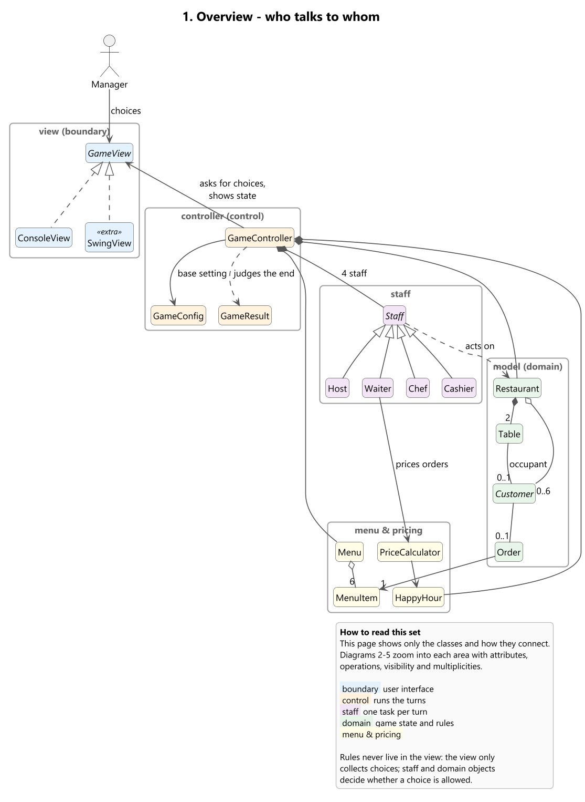
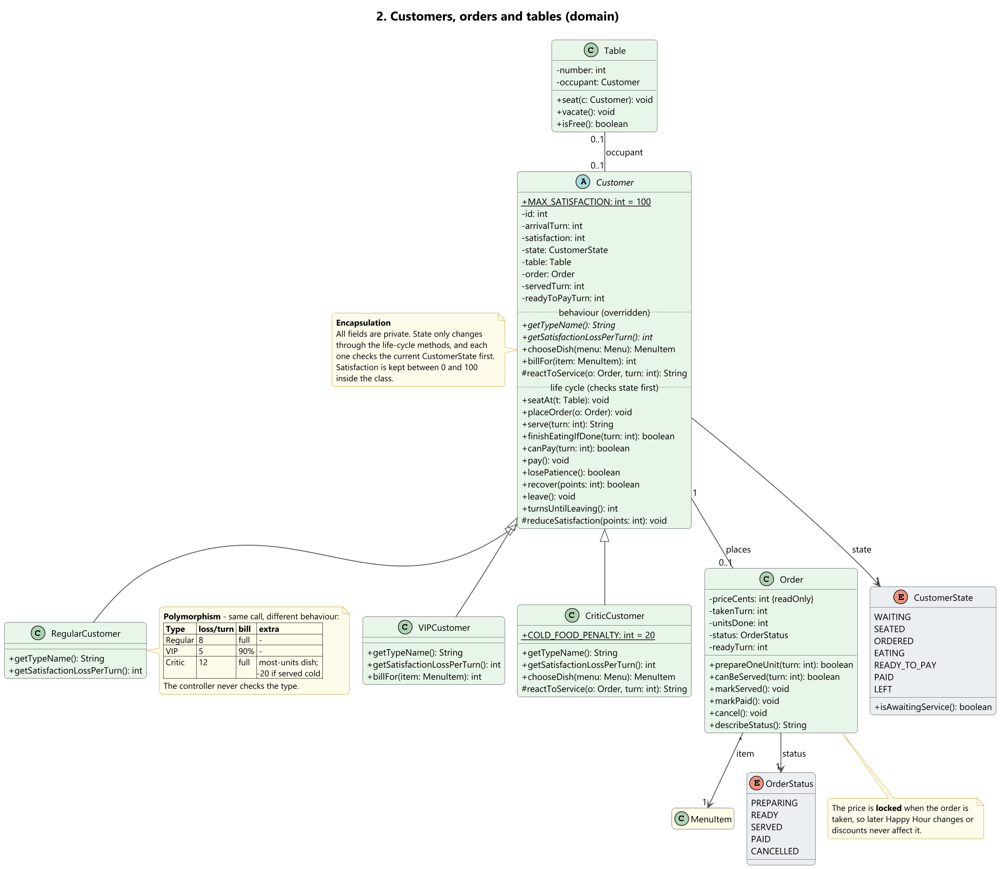
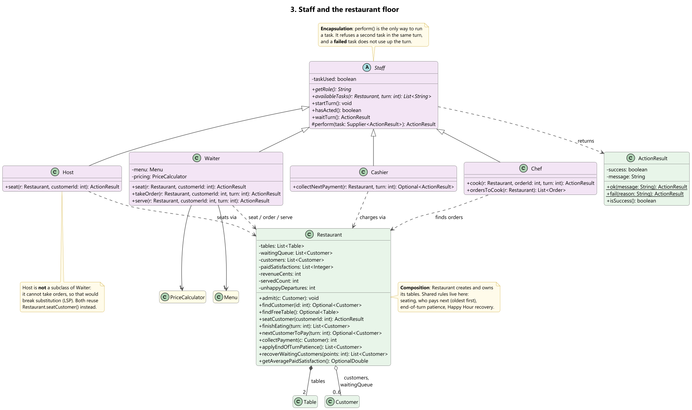
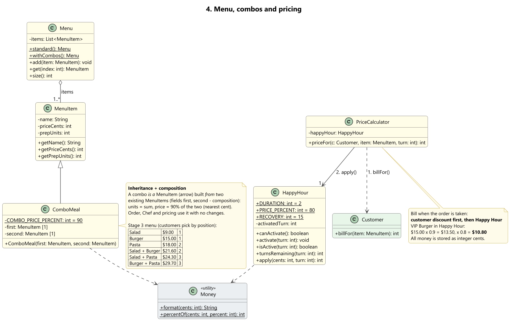
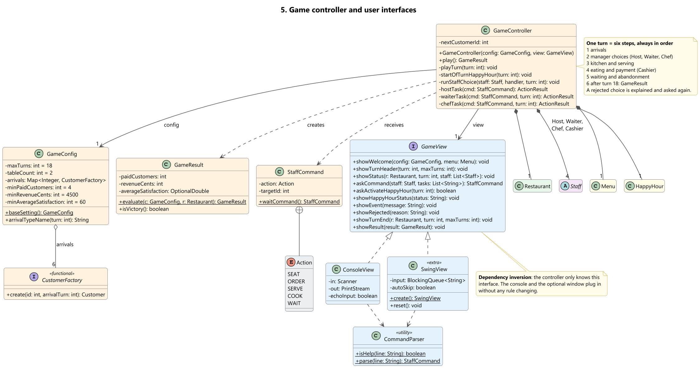
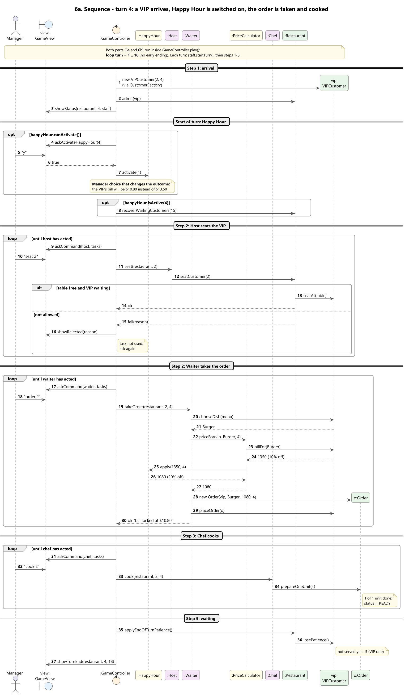
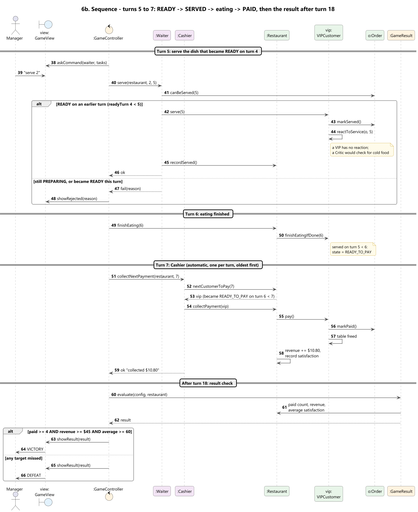
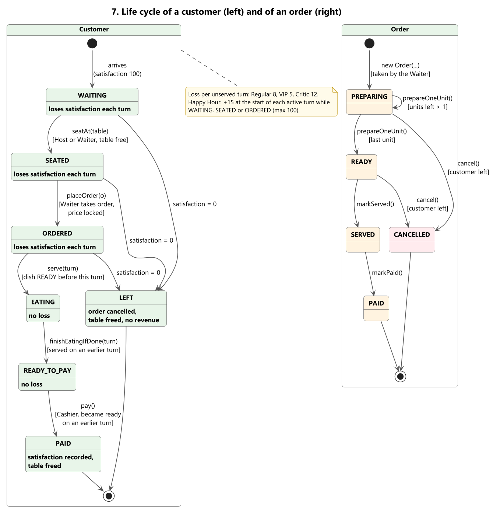

# Readable UML set

The final design (Stage 3, plus the optional window marked `<<extra>>`) split into small diagrams that each fit on one page. They share one colour code:

| Colour | Layer |
|---|---|
| blue | boundary (user interface) |
| orange | control (runs the turns) |
| purple | staff (one task per turn) |
| green | domain (game state and rules) |
| yellow | menu and pricing |
| grey | enums and utilities |

Read them in order:

| # | Diagram | What it shows |
|---|---|---|
| 1 | [Overview](1-overview.png) | Every main class and how they connect, no members. Start here. |
| 2 | [Customers, orders, tables](2-customers-and-orders.png) | Customer hierarchy (polymorphism table), Order, Table, enums |
| 3 | [Staff and restaurant](3-staff-and-restaurant.png) | Staff hierarchy, Restaurant, ActionResult |
| 4 | [Menu and pricing](4-menu-and-pricing.png) | MenuItem / ComboMeal, PriceCalculator, HappyHour |
| 5 | [Controller and views](5-controller-and-views.png) | GameController, GameConfig, GameResult, GameView and its two implementations |
| 6a | [Sequence: turn 4](6a-sequence-turn4.png) | VIP arrives, Happy Hour, Host seats, Waiter orders, Chef cooks |
| 6b | [Sequence: turns 5-7 and result](6b-sequence-turns5to7-result.png) | READY -> SERVED -> eating -> PAID, then victory / defeat |
| 7 | [Life cycles](7-customer-and-order-lifecycle.png) | States of a customer and of an order, with the method that causes each change |

The single all-in-one diagrams are still in the folder above (`../class-diagram.png`, `../sequence-diagram.png`) for anyone who wants everything on one page.

**Editing:** change the `.puml` file and re-render with PlantUML (for example IntelliJ's *PlantUML Integration* plugin, or `java -jar plantuml.jar *.puml` in this folder). Colours and fonts are shared in `style.iuml`.

